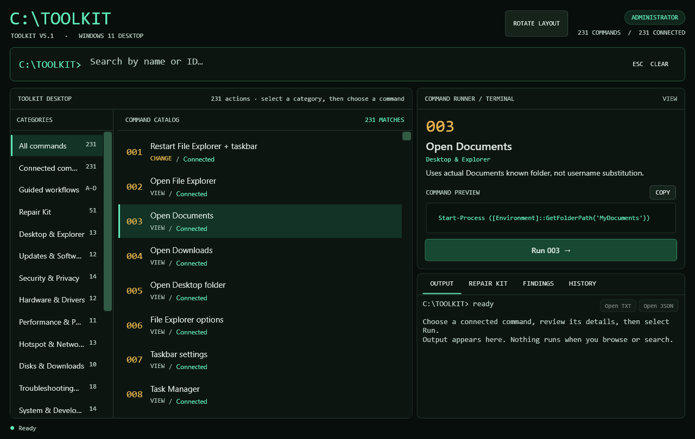
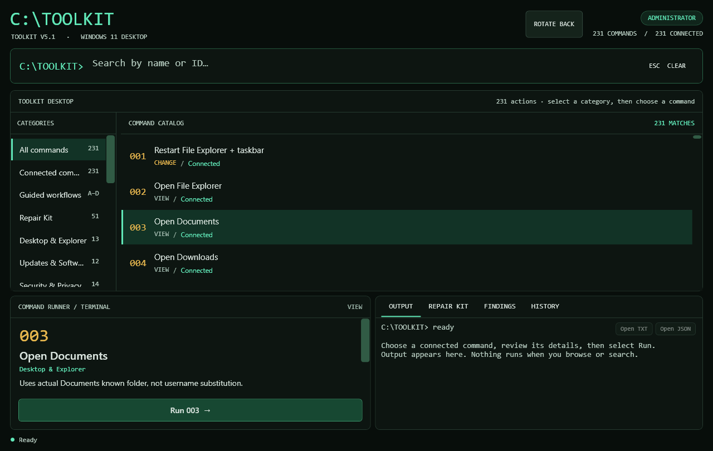

# Toolkit V5.1

A menu-driven **Windows 11 troubleshooting, diagnostics and repair toolkit** built with Windows PowerShell 5.1.

- 180 actions across 15 categories, plus a 51-action Repair Kit.
- Four guided workflows: General Diagnostics, Deep Diagnostics, General Repair and Deep Repair.
- Diagnostics are **read-only** and save a TXT and JSON report.
- Repairs are never automatic: you pick one action and confirm it by typing `YES`.
- The original console package contains no bundled executables. The optional desktop package includes a compiled WPF app that runs the same Toolkit scripts.
- No API keys and no Windows Insider changes.





## Choose how to open Toolkit

| Version | Download | Requirements |
| --- | --- | --- |
| Original command-prompt Toolkit V5.1 | [Console ZIP — 156 KB](https://github.com/cammaxwel-droid/Toolkit-v5.1/releases/download/desktop-v0.3.4/Toolkit-V5.1-Console.zip) | Windows 11, Windows PowerShell 5.1 and administrator access |
| Toolkit Desktop 0.3.4 | [Desktop ZIP](https://github.com/cammaxwel-droid/Toolkit-v5.1/releases/download/desktop-v0.3.4/Toolkit-Desktop-0.3.4-Windows-x64.zip) | Windows 11 x64, Windows PowerShell 5.1, administrator access and [.NET 10 Windows Desktop Runtime (x64)](https://dotnet.microsoft.com/en-us/download/dotnet/10.0) |

Desktop 0.3.4 improves text size and contrast, with the main Toolkit workspace on the left and the command runner and Repair Kit/output panels on the right. Rotate Layout moves the main screen above the runner and output panels for a taller arrangement. All Toolkit actions now run inside the same app window, including interactive terminal input. Its ZIP includes the matching Toolkit V5.1 and both launch methods.

Both ZIPs and the release notes are on the [Desktop 0.3.4 release page](https://github.com/cammaxwel-droid/Toolkit-v5.1/releases/tag/desktop-v0.3.4). GitHub's **Code → Download ZIP** gives you source files. To run Desktop from that ZIP, follow [Build the desktop from source](#build-the-desktop-from-source).

The original Toolkit targets Windows 11 Pro. Some checks depend on the Windows edition and available modules. WinGet is needed for WinGet actions only.

## Verify your download

Open Windows PowerShell in the folder containing the ZIP. Run the command for the file you downloaded and compare its hash with the matching filename in [SHA256SUMS.txt](https://github.com/cammaxwel-droid/Toolkit-v5.1/releases/download/desktop-v0.3.4/SHA256SUMS.txt).

```powershell
Get-FileHash -LiteralPath .\Toolkit-V5.1-Console.zip -Algorithm SHA256
Get-FileHash -LiteralPath .\Toolkit-Desktop-0.3.4-Windows-x64.zip -Algorithm SHA256
```

## Desktop quick start

1. Run `dotnet --list-runtimes` in PowerShell. Look for `Microsoft.WindowsDesktop.App 10.0.x` under `C:\Program Files\dotnet`. If the command is missing or there is no matching entry, install the .NET 10 **Windows Desktop Runtime for x64** linked above. The SDK is only needed to build the source.
2. Download the **Desktop ZIP** above, [verify it](#verify-your-download), then use **Extract All** to put the whole package in its own folder.
3. From the extracted folder, open `Start-Toolkit-Desktop.cmd` and approve the Administrator prompt.
4. Search for `171`, select **General Diagnostics**, and click **Run 171**. Look for two `SAVED:` lines in Output with the TXT and JSON report paths.

Keep `Toolkit-Desktop` and `Toolkit-V5.1` together. To use the original console instead, right-click `Toolkit-V5.1/Start-Toolkit.cmd` and choose **Run as administrator**. The download is portable; it does not install itself or create shortcuts automatically.

The desktop connects all 180 main commands and 51 Repair Kit commands, including the four existing guided workflows. The original questions and confirmations remain in place. Interactive prompts and terminal input appear in the same app window. Read the [desktop instructions and testing limits](Toolkit-V5.1-GitHub/Toolkit-Desktop/README.md) before using it.

## Build the desktop from source

Install the .NET 10 SDK, then run in Windows PowerShell from the repository root:

```powershell
powershell.exe -NoLogo -NoProfile -ExecutionPolicy Bypass -File .\Toolkit-V5.1-GitHub\Toolkit-Desktop\Build-Desktop.ps1 -Verify
```

Then open `Toolkit-V5.1-GitHub/Start-Toolkit-Desktop.cmd`. The build reads the existing Toolkit source to generate its command catalog; it does not modify the original Toolkit. Automated checks use disposable fixtures and off-screen WPF rendering, not real repairs or installers.

## Original Toolkit quick start

1. Download the **Console ZIP** from the table above and [verify it](#verify-your-download).
2. Right-click the zip → **Properties** → tick **Unblock** if it appears → **OK**.
3. Extract it into its own folder. Do not run it from inside the zip.
4. Open the `Toolkit-V5.1` folder, right-click `Start-Toolkit.cmd` and choose **Run as administrator**.
5. Type `A` and press Enter for **General Diagnostics**. Look for two `SAVED:` lines with the TXT and JSON report paths.

## Privacy

General Diagnostics saves TXT and JSON reports to `Toolkit-Reports` in your Windows Documents folder. If Documents is unavailable, check `%USERPROFILE%\Toolkit-Reports`. Reports can contain usernames, local paths and hardware or network details. **Review and redact them before sharing anywhere**, including GitHub issues.

## Documentation

The full package lives in [`Toolkit-V5.1-GitHub/Toolkit-V5.1/`](Toolkit-V5.1-GitHub/Toolkit-V5.1/):

- [Full README](Toolkit-V5.1-GitHub/Toolkit-V5.1/README.md): features, categories and safety limits
- [Guided workflows](Toolkit-V5.1-GitHub/Toolkit-V5.1/docs/Guided-Workflows.md)
- [Testing checklist](Toolkit-V5.1-GitHub/Toolkit-V5.1/TESTING.md)
- [Changelog](Toolkit-V5.1-GitHub/Toolkit-V5.1/CHANGELOG.md)

The [original Toolkit archive](Toolkit-V5.1-GitHub.zip) and its [checksum](Toolkit-V5.1-GitHub.zip.sha256) are also available.

## Contributing and security

See [CONTRIBUTING.md](CONTRIBUTING.md) and [SECURITY.md](SECURITY.md). Please report vulnerabilities privately, not in public issues.

## Disclaimer

Use at your own risk. Read what an action does before confirming any change, and keep a backup of important data. Not affiliated with Microsoft.

## License

[MIT](LICENSE)
